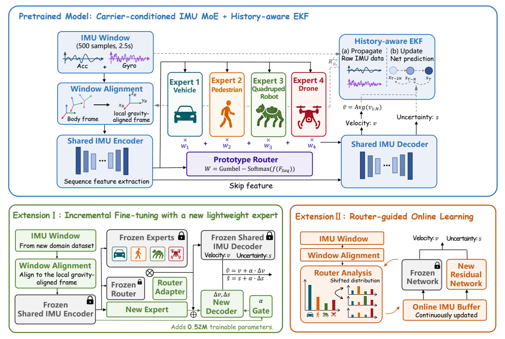

# MosaicIMU: Composing Carrier Experts for Generalizable Neural Inertial Odometry

**One pretrained model. Four carrier priors. Adaptive expert composition.**

Junye Zou*, Huiyi Yan*, Xinning Xu, Xiaolei Li, Pengkun Zhou, Jinhui Zhang, Ziyang Meng†

-  Equal contribution · † Corresponding author

   

[Paper](https://arxiv.org/abs/2606.09355) · [Quick Start](#quick-start) · [Training](#training) · [Citation](#citation)

MosaicIMU is a carrier-conditioned **Mixture-of-Experts (MoE)** framework for inertial odometry across vehicles, quadruped robots, pedestrians, and drones. A prototype router composes carrier-specific features for each IMU window; a shared decoder predicts local velocity and uncertainty; and a history-aware EKF turns these predictions into trajectory estimates. For unseen domains, a lightweight residual branch adapts the model while keeping the pretrained base frozen.



## 📚 Contents

- [📰 News](#news)
- [🧭 Overview](#overview)
- [🧩 Available Components](#available-components)
- [⚙️ Installation](#installation)
- [🚀 Quick Start](#quick-start)
- [📦 Data Preparation](#data-preparation)
- [📊 Evaluation](#evaluation)
- [🔥 Training](#training)
- [🔌 Model API](#model-api)
- [📁 Repository Layout](#repository-layout)
- [🛠️ Troubleshooting](#troubleshooting)
- [📄 Citation](#citation)
- [📧 Contact](#contact)
- [🙏 Acknowledgments](#acknowledgments)


## 📰 News

- **[2026.09]** Our paper has been accepted to **CoRL 2026** and  selected for a **Spotlight presentation**.
- **[2026.09]** Our released pretrained weights are trained with TartanIMU’s latest open-source dataset.


## 🧭 Overview

1. **Align the IMU window.** Transform a 500-sample, 200 Hz IMU sequence into a local gravity-aligned frame, **L0**, whose yaw is fixed at the start of the window.
2. **Compose carrier experts.** A shared encoder extracts temporal features. A prototype-based router assigns soft weights to four experts, combining their features before a shared decoder.
3. **Predict velocity and uncertainty.** The network produces dense 3D velocities and positive per-axis velocity variances in L0.
4. **Fuse with inertial propagation.** Aggregate predictions into a segment-level average-velocity constraint between historical pose clones. An MSCKF-style error-state EKF estimates position, velocity, orientation, and IMU biases.
5. **Adapt to a new domain.** Freeze the base model and train a router adapter, a new expert, a residual decoder, and a gate to correct target-domain predictions.

The paper also introduces **router-guided online adaptation**: select informative windows using carrier-distribution mismatch and update the lightweight branch on an edge device. This extension uses reference supervision during adaptation.


| Stage           | Input                                                                                      | Output                                                                   |
| --------------- | ------------------------------------------------------------------------------------------ | ------------------------------------------------------------------------ |
| Data interface  | Body-frame acceleration and angular velocity, with reference poses for training/evaluation | Aligned windows and supervision                                          |
| Neural model    | L0-aligned IMU tensor `(B, 6, 500)`                                                        | Velocity `(B, 500, 3)`, variance `(B, 500, 3)`, routing weights `(B, 4)` |
| State estimator | Raw IMU propagation + learned segment constraints                                          | Estimated trajectory and inertial state                                  |


**Frame distinction:** stored IMU measurements are in the body frame; the network consumes measurements transformed into L0. During trajectory evaluation, this transformation uses the filter's estimated attitude. The supplied evaluator uses reference poses for initialization and error computation.

## 🧩 Available Components


| Component                    | Entry point                                          |
| ---------------------------- | ---------------------------------------------------- |
| Four-carrier MoE pretraining | `[train_pretrain.py](train_pretrain.py)`             |
| Pretrained base weights      | `[checkpoint/best_moe.pth](checkpoint/best_moe.pth)` |
| Offline residual adaptation  | `[train_weight_tune.py](train_weight_tune.py)`       |
| History-aware EKF evaluation | `[eval.py](eval.py)`                                 |


## ⚙️ Installation

```bash
git clone https://github.com/zoujy02/MosaicIMU.git
cd MosaicIMU

conda create -n mosaicimu python=3.10 -y
conda activate mosaicimu

python -m pip install -r requirements.txt
```

GPU training needs a CUDA-enabled PyTorch build compatible with your NVIDIA driver. The scripts use CUDA when available and otherwise fall back to CPU.

```bash
python -c "import torch; print('PyTorch:', torch.__version__); print('CUDA:', torch.cuda.is_available())"
python eval.py --help
python train_pretrain.py --help
python train_weight_tune.py --help
```

## 🚀 Quick Start

1. Prepare a synchronized 200 Hz NPZ sequence containing `ts`, `imu`, `pos`, and `quat` using the conventions below.
2. Place a vehicle sequence at `data/data_baseline/test/car/example.npz`.
3. Evaluate the bundled model:

```bash
python eval.py --mode pretrain --carrier car --weights checkpoint/best_moe.pth
```

Inspect the trajectory plot and metrics under `test_results_visualizations/pretrain_car/`.

No dataset is bundled, so this requires your own prepared sequence. For meaningful RTE-10s with native-carrier defaults, use a sequence longer than 20 seconds: evaluation discards the initial 10 seconds, and RTE requires more than another 10 seconds of evaluated data.

## 📦 Data Preparation

### NPZ schema

Each file represents one synchronized trajectory or one already-separated train/validation segment.


| Key    | Shape    | Units / convention                                                    |
| ------ | -------- | --------------------------------------------------------------------- |
| `ts`   | `(N,)`   | Strictly increasing timestamps, seconds                               |
| `imu`  | `(N, 6)` | `[acc_x, acc_y, acc_z, gyro_x, gyro_y, gyro_z]`; m/s² and rad/s       |
| `pos`  | `(N, 3)` | Reference world-frame position, meters                                |
| `quat` | `(N, 4)` | Unit quaternion in SciPy order `[x, y, z, w]`; body-to-world rotation |


Supply measured accelerometer specific force; do not subtract gravity before passing it to the filter. The estimator handles gravity during propagation. A stationary sensor aligned with the world axes should be consistent with positive vertical specific force and world gravity along negative z.

`quat` is a SciPy `[x, y, z, w]` unit quaternion that rotates **body-frame vectors into the world frame** (`Rotation.from_quat(quat).apply(body_vector)`).

Before saving:

- Resample and synchronize all streams to **200 Hz**, using rotation-aware interpolation for orientations.
- Keep array lengths equal, values finite, and quaternions normalized.
- Convert gyro units from degrees/s to radians/s if needed, and verify sensor axes and world-frame conventions.
- Use more than **500 samples** per training segment. The current window loop produces no training window for exactly 500 frames.
- Provide reference positions and orientations for supervised training and the supplied evaluation workflow.

```python
import numpy as np

# ts, imu, pos, and quat are synchronized arrays prepared from your dataset.
np.savez_compressed("sequence.npz", ts=ts, imu=imu, pos=pos, quat=quat)
```

Training derives velocity from position differences at a fixed 200 Hz. Changing only evaluation `dt` does not convert a dataset or update this training assumption.

### Directory layout and labels

```text
data/
├── data_baseline/
│   ├── train/
│   │   ├── car/*.npz
│   │   ├── quadrupedal/*.npz
│   │   ├── pedestrian/*.npz
│   │   └── drone/*.npz
│   ├── val/                       # Same four carrier subdirectories
│   └── test/                      # Same four carrier subdirectories
└── weight_tune/
    ├── train/
    │   ├── weight_robot/*.npz      # Target-domain training data
    │   └── ...                    # Optional native-carrier replay folders
    ├── val/
    │   ├── weight_robot/*.npz      # Target-domain validation data
    │   └── ...                    # Optional native-carrier validation folders
    └── test/*.npz                 # Target-domain test files directly here
```


| Folder / identifier | Code label | Meaning                               |
| ------------------- | ---------- | ------------------------------------- |
| `car`               | 0          | Vehicle                               |
| `quadrupedal`       | 1          | Quadruped robot                       |
| `pedestrian`        | 2          | Pedestrian                            |
| `drone`             | 3          | Drone                                 |
| `weight_robot`      | 4          | Target domain for residual adaptation |


`weight_robot` is a target-domain identifier, not a requirement that data come from a particular robot. The default adaptation prior emphasizes the pedestrian expert, consistent with the paper's head-mounted TLIO experiment. The base router always has **four** weights, in code order `[car, quadrupedal, pedestrian, drone]`; the new residual expert uses a separate gate.

### Dataset availability

Raw source datasets used in the paper (and related open releases) are listed below. This repository does **not** redistribute them; download from the official pages and convert to the NPZ format above.


| Category                         | Source datasets                                                                                                                |
| -------------------------------- | ------------------------------------------------------------------------------------------------------------------------------ |
| Vehicle                          | [i2Nav-Robot](https://github.com/i2Nav-WHU/i2Nav-Robot), [SubT-MRS](https://superodometry.com/datasets)                        |
| Quadruped                        | [CEAR](https://daroslab.github.io/cear/), [Cerberus](https://github.com/leggedrobotics/cerberus_darpa_subt_datasets)           |
| Pedestrian                       | [IDOL](https://zenodo.org/records/4484093), [RNIN-VIO](https://zju3dv.github.io/rnin-vio/)                                     |
| Drone                            | [BlackBird](https://github.com/mit-aera/Blackbird-Dataset), [MILUV](https://doi.org/10.25452/figshare.plus.28386041.v1)        |
| Mixed                            | [TartanIMU](https://huggingface.co/datasets/raphael-blanchard/TartanIMU) ([project page](https://superodometry.com/tartanimu)) |
| Unseen-domain offline adaptation | [TLIO](https://github.com/CathIAS/TLIO) ([project page](https://cathias.github.io/TLIO/)), excluded from pretraining           |


## 📊 Evaluation

Two flags control what is evaluated and how each sequence is labeled for the filter:


| Flag               | Role                                                                          | Choices                                                                                                                                                                                                                            |
| ------------------ | ----------------------------------------------------------------------------- | ---------------------------------------------------------------------------------------------------------------------------------------------------------------------------------------------------------------------------------- |
| `--carrier`        | Which carriers to run (or keep)                                               | `all` (default), or any of `car`, `quadrupedal`, `pedestrian`, `drone`; with `--mode weight_tune` also `weight_robot`. Multiple names allowed (`car drone` or `car,drone`).                                                        |
| `--carrier-source` | How each sequence gets its carrier label (and thus which MSCKF preset to use) | `dataset`: trust the folder name under `<data-root>/<carrier>/`. `router`: ignore folder names; classify each trajectory with the MoE router. `yaml`: use `base.carrier_source` from the config (currently defaults to `dataset`). |


`--carrier` selects the set; `--carrier-source` decides the labeling rule. They combine, for example `--carrier car --carrier-source router` only keeps trajectories that the router classifies as `car`.

**Defaults if you omit both flags** (equivalent to `python eval.py --mode pretrain`):

- `--carrier all` → the four native carriers `car`, `pedestrian`, `quadrupedal`, `drone`
- `--carrier-source yaml` → reads `base.carrier_source`, which is `**dataset**` in the shipped config

### Folder-based labeling (`--carrier-source dataset`)

Use when NPZ files already sit in the four native folders `car`, `quadrupedal`, `pedestrian`, `drone`. Only `<data-root>/<carrier>/*.npz` is read (non-recursive).

```bash
# All four native carriers (from folder names)
python eval.py --mode pretrain --carrier-source dataset

# Only vehicle and drone folders
python eval.py --mode pretrain --carrier-source dataset --carrier car,drone

# Custom root / output
python eval.py --mode pretrain --carrier-source dataset --carrier car \
  --data-root data/my_test --output-dir results/my_test

# Override checkpoint (default: checkpoint/best_moe.pth)
python eval.py --mode pretrain --carrier-source dataset --carrier car \
  --weights /path/to/your.pth
```

### Router-based labeling (`--carrier-source router`)

Use when folder names are unreliable or mixed. Recursively finds `**/*.npz` under `--data-root`, runs an IMU-propagation pass, averages router weights over the trajectory, and assigns one of the four native carriers (argmax). That label selects the MSCKF preset. Writes `router_detect_summary.txt`. **Pretrain only.**

This is trajectory-level labeling for the filter. Per-window expert mixing inside the network remains soft routing either way.

```bash
# Label every sequence with the router, then evaluate all detected native carriers
python eval.py --mode pretrain --carrier-source router --data-root data/my_test

# Same, but keep only sequences the router calls car
python eval.py --mode pretrain --carrier-source router --carrier car --data-root data/my_test
```

### Adapted-model evaluation

After [offline adaptation](#offline-adaptation). Target-domain test data come from `carriers.weight_robot.data_dir`. Default weights: `base.weight_tune_weights` (`checkpoint/best_weight_tune.pth`).

```bash
# Target domain (default adapted checkpoint)
python eval.py --mode weight_tune --carrier weight_robot

# Override adapted checkpoint path
python eval.py --mode weight_tune --carrier weight_robot \
  --weights /path/to/best_weight_tune.pth

# Target domain and all four native carriers
python eval.py --mode weight_tune
```

### Outputs and metric conventions

Outputs appear under `<output-dir>/<mode>_<carrier>/`:


| Output           | Contents                                                            |
| ---------------- | ------------------------------------------------------------------- |
| `*_traj.png`     | Reference, EKF, and integrated network 3D trajectories              |
| `*_metrics.txt`  | Per-sequence trajectory metrics                                     |
| Terminal summary | Per-sequence metrics and per-carrier path-length-weighted summaries |


**ATE** is position RMSE. **RTE-10s** is displacement-error RMSE over 10-second intervals. Both 3D and horizontal 2D metrics are computed. 

## 🔥 Training

### Base-model pretraining

Set `data.train_dir` and `data.val_dir` in `[configs/train_config.yaml](configs/train_config.yaml)`:

```bash
python train_pretrain.py --config configs/train_config.yaml
```


| Setting                        | Default           |
| ------------------------------ | ----------------- |
| Window / stride                | 500 / 250 samples |
| Batch size                     | 128               |
| Maximum epochs                 | 100               |
| Learning rate / cosine minimum | 0.001 / 0.00001   |
| Early-stopping patience        | 15                |
| Router temperature             | 3.0               |


The implementation balances carriers by source duration and combines velocity/uncertainty supervision with carrier-prior and prototype regularization. The default configuration enables an additional displacement loss from epoch 51 (`stage_switch_epoch: 50`).

Training writes `checkpoint/best_moe.pth` and `checkpoint/last_moe.pth`. **A new run can overwrite the bundled best checkpoint.** To retain it, copy the training YAML and choose distinct `pretrain_training.ckpt_best` and `pretrain_training.ckpt_last` filenames before starting.

```bash
# Continue from an epoch-aware checkpoint
python train_pretrain.py --resume checkpoint/last_moe.pth --epochs 100

# Continue from the bundled weights, identified by the release as epoch 12
python train_pretrain.py --resume checkpoint/best_moe.pth --resume_epoch 12 --epochs 100
```

`--resume_epoch` is the last completed epoch; `--epochs` is the total target epoch count. Resume loads weights and epoch metadata. Optimizer and scheduler state are not saved, so this is not a bitwise continuation of an interrupted run.

### Offline adaptation

1. Prepare target training/validation data under `weight_robot/`; optional native-carrier replay uses the original folder names.
2. Set `weight_tune_paths.pretrained_weights`, `data_dir`, and `val_dir` in the training YAML.
3. Choose a target-appropriate `weight_tune_training.router_prior` in code order `[car, quadrupedal, pedestrian, drone]`.
4. Run:

```bash
python train_weight_tune.py --config configs/train_config.yaml
```

The default prior is `[0.05, 0.05, 0.85, 0.05]`. Training freezes the base, including its evaluation-mode batch-normalization behavior, and updates the router adapter and gated residual branch. Defaults are batch size 256, up to 100 epochs, and periodic checkpoints every 5 epochs. The best checkpoint is selected using target-domain validation drift.

```text
checkpoint/
├── best_moe.pth                 # Pretrained base
├── best_weight_tune.pth         # Best adapted model
├── weight_tune_epoch_0005.pth   # Periodic snapshots
└── ...
```

Despite the name `train_weight_tune.py`, adaptation trains additional residual-network parameters as well as routing corrections; it does not update only a fixed mixing-weight vector.

## 🔌 Model API

This example predicts one **already aligned** dataset window using the bundled model. It requires prepared data and does not run the EKF.

```python
import torch
from src.datasets.imu_dataset import IMUMoENpzDataset
from src.models.moe_net import CarrierConditionedMoE_Seq
from src.utils.training_helpers import load_model_checkpoint

device = torch.device("cuda" if torch.cuda.is_available() else "cpu")
state, _ = load_model_checkpoint("checkpoint/best_moe.pth", device)
model = CarrierConditionedMoE_Seq(
    in_channels=6, context_dim=128, expert_dim=64,
    num_experts=4, seq_len=500,
).to(device)
model.load_state_dict(state)
model.eval()

dataset = IMUMoENpzDataset(
    "data/data_baseline/test", mode="val", categories={"car": 0},
    window_size=500, step_size=250,
)
assert len(dataset) > 0, "Prepare a car NPZ sequence longer than 500 samples."
x_l0 = dataset[0][0].unsqueeze(0).to(device)  # (1, 6, 500)
with torch.no_grad():
    velocity, variance, weights, _ = model(
        x_l0, temperature=3.0, use_gumbel=False,
    )
print(velocity.shape, variance.shape, weights.shape)
# torch.Size([1, 500, 3]) torch.Size([1, 500, 3]) torch.Size([1, 4])
```

The network expects **L0-aligned** IMU windows, not raw body-frame measurements. In this snippet, `IMUMoENpzDataset` builds that alignment from the NPZ **reference** `quat`. For full trajectory evaluation, use `eval.py` instead: it aligns with the **filter’s estimated** attitude and runs the history-aware EKF.

## 📁 Repository Layout

```text
MosaicIMU/
├── README.md
├── assets/                       # Original paper figures for this README
├── requirements.txt              # Pip dependency list
├── train_pretrain.py              # Four-carrier base training
├── train_weight_tune.py           # Frozen-base residual adaptation
├── eval.py                       # Network + history-aware EKF evaluation
├── configs/
│   ├── train_config.yaml
│   └── test_config.yaml
├── checkpoint/
│   └── best_moe.pth
└── src/
    ├── datasets/                 # NPZ loading, alignment, augmentation
    ├── models/                   # Encoder, experts, router, decoders, adaptation
    ├── filter/                   # MSCKF-style inertial estimator
    └── utils/                    # Losses, checkpoints, metrics, visualization
```


## 🛠️ Troubleshooting


| Symptom                                | What to check                                                                                                             |
| -------------------------------------- | ------------------------------------------------------------------------------------------------------------------------- |
| No files or windows found              | Run from the repository root; check paths and exact folder names. Training segments need more than 500 samples.           |
| No batches on a small training dataset | The loader uses `drop_last=True`; reduce batch size so at least one full batch exists.                                    |
| Checkpoint head mismatch               | Ensure the checkpoint matches the current temporal decoder heads.                                                         |
| Adaptation checkpoint missing          | Run adaptation first or provide compatible adapted weights. Only base weights are bundled.                                |
| RTE-10s is `NaN`                       | Supply more than 10 seconds of evaluated data after burn-in.                                                              |
| Large drift on custom data             | Check quaternion direction/order, gravity, gyro units, synchronization, sample rate, initialization, and filter settings. |
| High RAM or GPU usage                  | The loader materializes sliding windows in memory. Start with fewer trajectories and a smaller batch size.                |


## 📄 Citation

If MosaicIMU is useful in your research, please cite:

```bibtex
@misc{zou2026mosaicimu,
  title         = {{MosaicIMU}: Composing Carrier Experts for Generalizable Neural Inertial Odometry},
  author        = {Zou, Junye and Yan, Huiyi and Xu, Xinning and Li, Xiaolei and
                   Zhou, Pengkun and Zhang, Jinhui and Meng, Ziyang},
  year          = {2026},
  eprint        = {2606.09355},
  archivePrefix = {arXiv},
  primaryClass  = {cs.RO},
  url           = {https://arxiv.org/abs/2606.09355}
}
```

## 📧 Contact

For questions about this work, please contact [Junye Zou](mailto:zoujy21@mails.tsinghua.edu.cn) or [Ziyang Meng](mailto:ziyangmeng@mail.tsinghua.edu.cn).

## 🙏 Acknowledgments

We thank the authors and maintainers of the source datasets listed in [Dataset availability](#dataset-availability). We also thank the open-source releases of [TartanIMU](https://github.com/superxslam/TartanIMU) and [TLIO](https://github.com/CathIAS/TLIO), which helped this research.